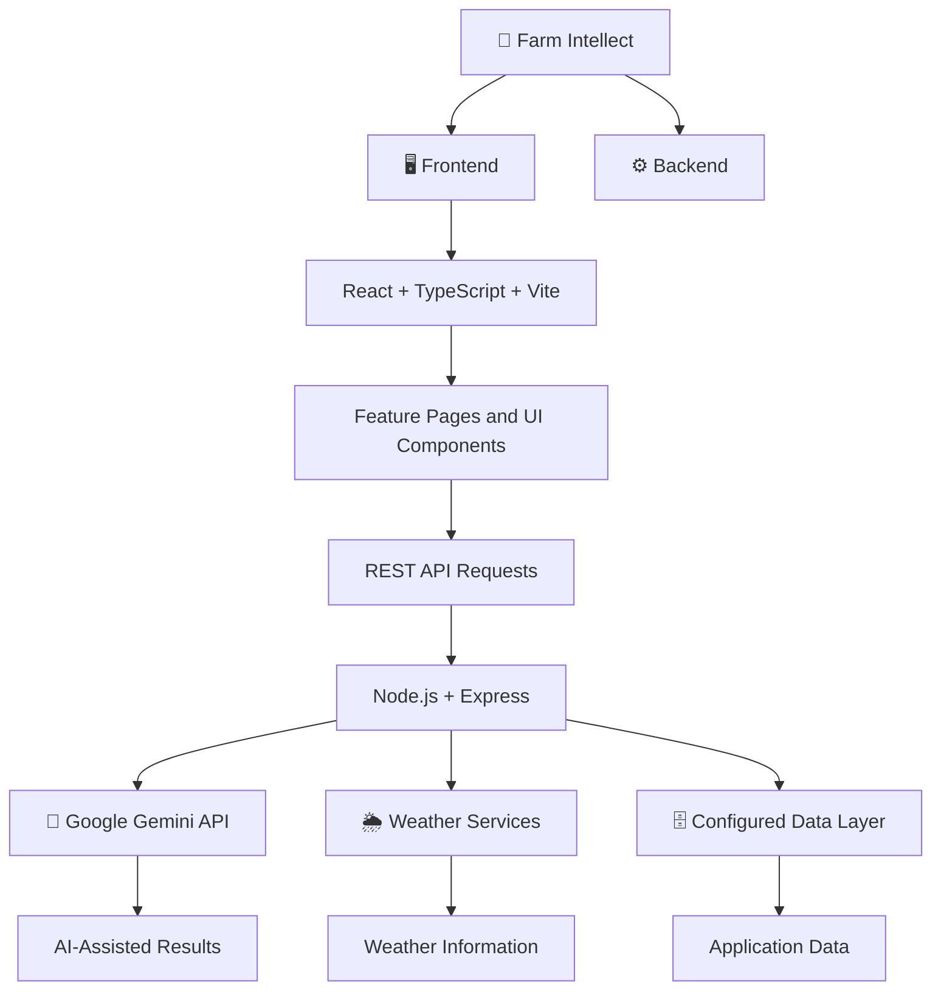

 <div align="center">

# 🌾 FARM INTELLECT

### 🚜 AI-Powered Smart Farming & Agricultural Intelligence

<p align="center">
  
  
  
  
</p>

**🌱 Smarter Decisions • 🌾 Better Farming • 🌍 Sustainable Agriculture**

*A unified agricultural application combining AI-assisted recommendations, weather information, market insights, and smart farming tools.*

[🚀 Getting Started](#-getting-started) · [✨ Features](#-features) · [🛠️ Tech Stack](#️-technology-stack) · [👩‍💻 Developer](#-developer)

</div>

---

## 📑 Table of Contents

- [🌱 About the Project](#-about-the-project)
- [🎯 Vision and Mission](#-vision-and-mission)
- [✨ Features](#-features)
- [🏗️ Architecture](#️-application-architecture)
- [🛠️ Technology Stack](#️-technology-stack)
- [📂 Project Structure](#-project-structure)
- [🚀 Getting Started](#-getting-started)
- [🔐 Configuration and Security](#-configuration-and-security)
- [🧪 Testing](#-testing)
- [🗺️ Future Enhancements](#️-future-enhancements)
- [🤝 Contributing](#-contributing)
- [👩‍💻 Developer](#-developer)

---

## 🌱 About the Project

**Farm Intellect** is an AI-powered smart farming application developed to support agricultural decision-making through modern web technologies and artificial intelligence.

Farmers face challenges related to crop selection, weather uncertainty, market price changes, irrigation, and sustainable agricultural practices. Farm Intellect brings multiple digital farming tools together in one application to help users access useful information and explore AI-assisted recommendations.

> 🌾 *Bringing intelligent technology closer to the people who grow our food.*

### 🎯 Vision and Mission

**🔭 Vision**

To make digital agricultural tools more accessible and support a future where farmers can make informed, technology-assisted decisions.

**🚀 Mission**

- 🌱 Support informed crop selection and planning.
- 🌦️ Make relevant weather information accessible.
- 📈 Provide AI-assisted agricultural market forecasts.
- 💧 Encourage efficient farming and irrigation practices.
- 🌍 Promote awareness of environmental sustainability.
- 🤝 Support agricultural knowledge sharing and collaboration.

---

## ✨ Features

<table>
<tr>
<td width="50%" valign="top">

### 🌱 AI Crop Recommendations

AI-assisted crop suggestions designed to support crop selection and agricultural planning.

### 🌦️ Weather Information

Weather information for supported locations to help users consider changing conditions when planning farming activities.

### 📈 Market Price Prediction

AI-assisted price forecasts for selected agricultural commodities, including wheat, rice, maize, soybean, onion, and cotton.

</td>
<td width="50%" valign="top">

### 🔄 Crop Rotation Optimizer

A dedicated feature for exploring crop rotation plans and alternative cropping sequences.

### 🌍 Carbon Footprint Calculator

Tools for estimating the environmental footprint associated with farming activities.

### 💧 Smart Irrigation

Irrigation support designed to help users consider water management and available weather information.

</td>
</tr>
<tr>
<td width="50%" valign="top">

### 👨‍🌾 Farmer Collaboration Hub

A dedicated interface for agricultural knowledge sharing and farmer collaboration.

### 🗣️ Multilingual Voice Assistant

A language- and voice-oriented interface designed to improve accessibility to agricultural assistance.

</td>
<td width="50%" valign="top">

### 👥 User Management

An administration interface for viewing users and managing roles such as Farmer, Merchant, Expert, and Admin.

### 📱 Integrated Application Interface

A component-based React application with navigation and dedicated interfaces for farming features.

</td>
</tr>
</table>

> **Note:** Availability of individual features depends on their current implementation, backend route registration, and service configuration. AI predictions are estimates, not guaranteed outcomes.

---

## 🏗️ Application Architecture

Farm Intellect uses a frontend–backend architecture in which the React application communicates with backend REST APIs.



---

## 🛠️ Technology Stack

<div align="center">

| Layer | Technologies |
|:---|:---|
| 🎨 Frontend | React, TypeScript, Vite |
| 💅 Styling | Tailwind CSS, reusable UI components |
| ⚙️ Backend | Node.js, Express.js |
| 🤖 Artificial Intelligence | Google Gemini API |
| 🔌 Communication | REST APIs |
| 🗄️ Data Layer | Prisma-based integration where configured |
| 🧰 Development | Git, npm, Visual Studio Code |

</div>

---

## 📂 Project Structure

```text
Farm_Intellect/
│
├── src/
│   ├── components/
│   │   ├── features/       # Farming feature interfaces
│   │   ├── layout/         # Shared application layout
│   │   └── ui/             # Reusable UI components
│   ├── contexts/           # Application contexts
│   ├── lib/                # API and utility functions
│   └── pages/              # Application pages, if present
│
├── backend/
│   └── src/
│       ├── config/         # Backend configuration
│       ├── middleware/     # Request middleware
│       ├── routes/         # API routes
│       ├── services/       # Application services
│       └── server.js       # Backend entry point
│
├── public/                 # Static assets
├── android/                # Android-related project files, if configured
├── package.json
├── .gitignore
└── README.md
```

*Directory descriptions are illustrative; refer to the repository for the exact current file structure.*

---

## 🚀 Getting Started

### 📋 Prerequisites

- [Node.js](https://nodejs.org/) and npm
- [Git](https://git-scm.com/)
- [Visual Studio Code](https://code.visualstudio.com/) or another editor
- A Google Gemini API key for AI functionality
- Database configuration if required by the backend

### 1️⃣ Clone the Repository

```bash
git clone https://github.com/meghanagowda75/Farm_Intellect.git
cd Farm_Intellect
```

### 2️⃣ Install Dependencies

Install frontend dependencies from the project root:

```bash
npm install
```

Install backend dependencies:

```bash
cd backend
npm install
cd ..
```

### 3️⃣ Configure Environment Variables

Create `backend/.env` and add the settings required by the backend.

```env
PORT=3001
GEMINI_API_KEY=your_gemini_api_key
GEMINI_MODEL=gemini-2.5-flash
```

Add any required database or external-service variables using the names expected by your actual configuration.

### 4️⃣ Start the Backend

Open a terminal:

```bash
cd backend
npm run dev
```

### 5️⃣ Start the Frontend

Open a second terminal in the project root:

```bash
npm run dev
```

Open the local development URL displayed by Vite.

> If a command is unavailable, check the relevant `package.json` scripts and use the command defined by the project.

---

## 🔐 Configuration and Security

- 🔑 Store API keys in environment variables.
- 🚫 Never commit `.env` files or private credentials.
- 🛡️ Validate API requests and protect sensitive operations.
- 👥 Apply appropriate authorization to administrative functionality.
- 🗄️ Configure the database according to the backend implementation.
- 🔒 Use production-grade authentication and security controls before deployment.

**Important:** This project version does not use Supabase as its application backend. Database and authentication behavior depend on the actual code and services configured in the repository. Development mock authentication should not be treated as production security.

---

## 🧪 Testing

Verify the following before deployment:

- [ ] Frontend starts successfully.
- [ ] Backend starts and responds to API requests.
- [ ] AI features work with valid API credentials.
- [ ] Weather information loads for supported locations.
- [ ] Market price prediction requests return expected responses.
- [ ] Feature pages display correctly.
- [ ] User management respects the intended permissions.
- [ ] Error handling works when an external service is unavailable.
- [ ] The application layout adapts to desktop and mobile screens.

Run the test commands defined in the project’s package scripts, if available.

---

## 🗺️ Future Enhancements

| Area | Potential Improvement |
|:---|:---|
| 🌱 Crop Intelligence | More region-specific crop recommendations |
| 📈 Market Analytics | Integration with verified agricultural market data |
| 💧 Irrigation | IoT-based irrigation monitoring |
| 🗣️ Accessibility | Expanded regional language support |
| 📊 Analytics | Detailed farm reports and dashboards |
| 📱 Mobile | Improved mobile application experience |
| 🔐 Security | Stronger production authentication and authorization |
| 🧪 Quality | Expanded automated testing |

*These are potential enhancements, not claims that all listed capabilities are already implemented.*

---

## 🤝 Contributing

Suggestions and contributions are welcome!

1. Fork the repository.
2. Create a feature branch.
3. Make your changes.
4. Test your changes.
5. Commit with a descriptive message.
6. Submit a pull request.

---

## 👩‍💻 Developer

<div align="center">

### **Meghana B M**

[](https://github.com/meghanagowda75)

[🌾 View Farm Intellect Repository](https://github.com/meghanagowda75/Farm_Intellect)

</div>

---

## 📄 License

Refer to the license file included in the repository for the applicable terms. If no license is specified, do not assume unrestricted reuse or distribution rights.

---

<div align="center">

### 🌱 FARM INTELLECT

**Smart Farming • Intelligent Decisions • Sustainable Future**

*Technology for agriculture. Intelligence for tomorrow.*

⭐ If you find this project useful, consider giving the repository a star!

</div>
